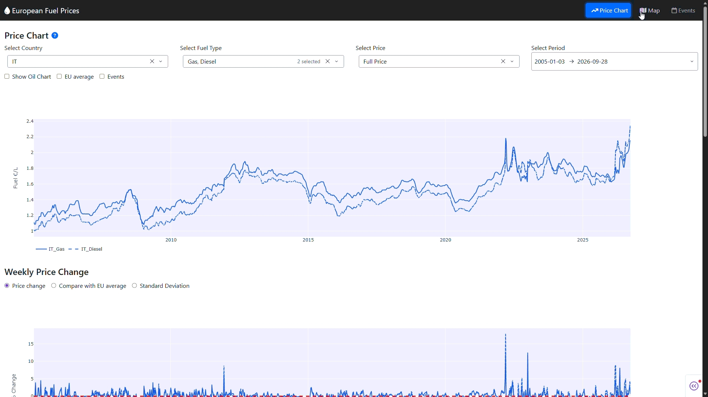

# Eurpean Fuel Analysis Dashboard

Have you ever wondered how the gasoline and diesel prices differ in countries inside the European Union, and how they are correlated with the oil's price? This project tries to answer this question giving a simple dashboard to compare historical weekly prices for these two fuels and compare them against the price of Brent oil, in order to be more aware of the recent spikes in prices. 

## 📊 Dashboard Structure



The dashboard is composed by three pages, contained inside the folder `pages/` and managed by `app.py`.

* **Price Chart** - the main page of the dashboard
    - Line chart of the weekly historical price of gasoline and diesel, with direct comparison between countries and against the EU average
    - Percentage change of the prices
    - Correlation comparison between series

* **Map** - visually compare each country's actual and past price directly from the continent's map 
* **Events** - compare the events impact over the period analyzed and the impact of the Italian Government's financial measures against fuel increase

## 🛠️ Data & Stack

### Data
 
*  **Gasoline and diesel** data  from the [Weekly Oil bulletin](https://energy.ec.europa.eu/data-and-analysis/weekly-oil-bulletin_en) published by the European Commission.
*  **Brent** price and **EUR/USD** change are extracted from Yahoo Finance and used to express crude oil prices in euros and investigate their relationship with retail fuel prices.
*  **Inflation** data from the HICP annual inflation rate in the Euro Area, published by the [European Central Bank](https://data.ecb.europa.eu/data/datasets/HICP/HICP.M.U2.N.000000.4D0.ANR).
*  **Events** data, used for comparison and impact of real world events, with event description and categorization assisted by ChatGPT. More focus was put on the recent USA-Iran conflict and on the Italian economic policies regarding fuel taxes.

### Stack 

The dashboard and the analysis are all conducted using Python and its libraries. 
* **yfinance** was used to retrieve the historical price of Brent oil and the exchange rate for the conversion in Euros.
*  **pandas** was used for the data processing stage.
*  **plotly dash** was used to construct the dashboard and deploy it on cloud.


## 📝 Scope & Limitations

The data was extracted from the European Commission site, to later proceed with data cleaning and tidying. Some inconsistencies across data registration might come directly from the methodology used by each Member State in measuring their domestic market and in their reporting to the European Commission.

In the analysis, only the Euro95 and Diesel fuels are considered, while the Liquid Gas prices were not accounted, due to the lack and inconsistent data across Countries.

The scope of this project is therefore to have a simple but effective dashboard to compare the evolution and the statistical relationship between crude oil and its derived fuel products, also in relation with the ongoing tension in the middle-east. 

The goal was also to increase the awareness of the general European situation, to understand the effect of such price increases on all Member States.

As an Italian Citizen, the focus on the fiscal policies was entirely on the Italian domestic policies taken to reduce or limit uncontrolled price increases, assessing the effective result of such tax cuts.

Some features, like better event analysis, comprehensive of also other Countries' domestic markets, have yet to be implemented, leaving room for substantial improvements.


## 🚀 Reproduction

Follow these steps to run the dashboard locally. The creation of a python virtual environment is highly recommended. \
(*Python 3.x version is required*)

1. Copy the repository on your device
    
    ```
    git clone https://github.com/adb-coding/fuel-analysis.git
    cd fuel-analysis
    ```
2. Install the required libraries 
    
    ```
    pip install -r requirements.txt
    ```

3. Run the script

    ```
    python app.py
    ```
    and access the dashboard at the link showed in the terminal window.

  